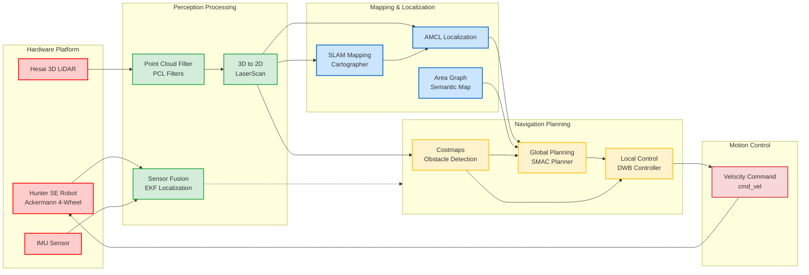

    

        
Campus logistics needs one vehicle that can leave open outdoor paths, enter indoor corridors, and keep moving under pedestrians and temporary obstacles. This stack runs on an AgileX Hunter SE: scene-switched localization, Cartographer mapping, and Nav2 planning that keeps re-routing around people.

        <ul>
            <li>Integrated <strong>Hesai PandarQT64</strong>, panoramic RGB, IMU/odometry on an Ackermann <strong>Hunter SE</strong> chassis into a ROS2 Humble vehicle.</li>
            <li>Split localization by domain: <strong>GPS-aided outdoor</strong> vs <strong>LiDAR-based indoor</strong>, with scene switching for dual-environment runs.</li>
            <li>Wired <strong>Google Cartographer</strong> for mapping and <strong>Nav2</strong> (SMAC global planner + DWB local controller + layered costmaps) for planning and control.</li>
            <li>Demonstrated <strong>real-time dynamic obstacle avoidance</strong> with path re-planning in crowded campus scenes.</li>
        </ul>
    

    

        

            <video class="campus-hero-video" id="campus-hero-video" autoplay muted loop playsinline preload="auto" aria-label="Indoor and outdoor delivery runs on a single Hunter SE platform">
                <source src="{{ site.baseurl }}/videos/campusautonomy.mp4" type="video/mp4">
                Your browser does not support the video tag.
            </video>
        

        

            <strong>Demo</strong>: Indoor/outdoor delivery runs on a single Hunter SE platform.
        

    

    

        
    

    

        
    

    Left: bare Hunter SE chassis. Right: completed delivery robot with LiDAR, cameras, and compute.

## Method

Hardware: Ackermann 4-wheel Hunter SE, 64-line 3D LiDAR, panoramic RGB, IMU. Perception downsamples and filters the cloud (PCL), projects 3D → 2D LaserScan for 2D planners, and fuses IMU/odometry with an EKF. Mapping uses Cartographer; indoor pose tracking uses AMCL (with an Area Graph semantic map available as a planning prior). Navigation uses SMAC globally and DWB locally against obstacle costmaps; `cmd_vel` closes the loop on the chassis.

    Sensor → perception → mapping/localization → Nav2 planning → chassis command.

## Results

Measured / claimed operating envelope from project tests:

- **Indoor localization**: ±0.2 m
- **Goal reaching**: 95% success rate
- **Collision safety**: 100% collision-free in the reported test set
- **Sensor processing**: 20 Hz
- **Endurance**: 4+ hours continuous operation
- **Payload**: up to 10 kg

## Failure Cases / Limitations

- **osmAG** map format is not yet integrated with Nav2 plugins; lifelong map updates and area-graph-native planning remain unfinished.
- Dual-environment switching is demonstrated, but robustness under varied weather and lighting is not fully characterized.
- Multi-robot / fleet coordination is out of scope for the current single-vehicle stack.

## Project Team

- **Lead developer**: Jiajie Zhang (zhangjj2023@shanghaitech.edu.cn)
- **Co-developer**: Yongqi Zhang (zhangyq12023@shanghaitech.edu.cn)
- **Advisor**: Professor Sören Schwertfeger

## Related Resources

- **Report**: [Campus Autonomy Final Report](/files/CampusAutonomy_FinalReport.pdf)
- **Code**: [campus-autonomy-course-project](https://github.com/jiajiezhang7/campus-autonomy-course-project)
