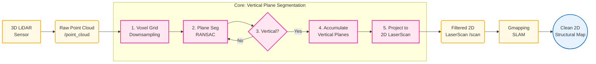

    

        <video class="demo-video" autoplay muted loop controls playsinline preload="auto">
            <source src="{{ '/videos/slam_projects.mp4' | relative_url }}" type="video/mp4">
            Your browser does not support the video tag.
        </video>
        

            <strong>Demo</strong>: Real-time map building with vertical plane filtering.
        

    

## Abstract

Indoor maps degrade when people, chairs, and temporary clutter enter the scan and get baked into occupancy. This project inserts a real-time **vertical plane segmentation** stage before 2D SLAM: RANSAC extracts large structural surfaces from 3D LiDAR, drops non-vertical / transient geometry, projects the remainder to a LaserScan, and feeds Gmapping so the resulting map stays structure-consistent across runs.

## Contributions

- Implemented a ROS1 Noetic node that **voxel-downsamples → RANSAC plane segments → keeps vertical planes → projects to 2D LaserScan**.
- Showed that filtering transient objects before SLAM yields **cleaner structural maps** than raw-scan Gmapping on the same corridors.
- Validated the pipeline in **Gazebo** and in **real laboratory corridors** with moving / temporary obstacles.
- Sustained **10 Hz** cloud processing and **1 Hz** map updates within a modest CPU/memory budget.

## Method

Design choice: rather than learn a semantic filter, exploit the geometric prior that walls dominate lifelong indoor structure. Pipeline:

1. Voxel grid downsampling of the raw `/point_cloud`
2. Iterative RANSAC plane segmentation
3. Verticality test: keep wall-like planes, reject floors / clutter planes
4. Accumulate retained vertical planes and project to a 2D `/scan`
5. Run Gmapping on the filtered scan to produce a structural occupancy map

    Raw 3D cloud → vertical plane filter (core) → filtered LaserScan → Gmapping → structural 2D map.

### Simulation and real-world validation

    

        
    

    

        
    

    Left: Gazebo simulation. Right: laboratory corridor deployment.

    

        
    

    

        
    

    Real-world maps: cluttered baseline Gmapping (left) vs. vertical-plane-filtered structural map (right).

## Results

- **Processing**: 10 Hz point cloud processing; 1 Hz map updates
- **Resources**: &lt; 200 MB memory; &lt; 25% CPU (Intel i7-8700K)
- **Map quality** (reported): 95% wall detection; 80% transient noise reduction; consistent maps over multiple runs

Stack: C++14 / Python, ROS1 Noetic, PCL, Eigen3, Gmapping, Gazebo Classic.

## Failure Cases / Limitations

- **Non-vertical structure** (ramps, large furniture, glass walls) can be under-represented or missed by the verticality gate.
- Pipeline is **ROS1 / Gmapping**-centric; ROS2 migration and alternative 2D SLAM backends are unfinished.
- No semantic labels (wall vs. door vs. glass); multi-floor mapping is not yet supported.
- Numbers above are from project tests / defense materials, not a formal published benchmark.

## Project Team

- **Developer**: Jiajie Zhang (zhangjj2023@shanghaitech.edu.cn)
- **Advisor**: Professor Sören Schwertfeger

## Related Resources

- **Slides**: [SLAM Project Defense](/files/CS284_SLAM_Project_Defence.pdf)
- **Demo video**: [System Demonstration](/videos/slam_projects.mp4)
- **Code**: [cs284_slam_project](https://github.com/jiajiezhang7/cs284_slam_project)
