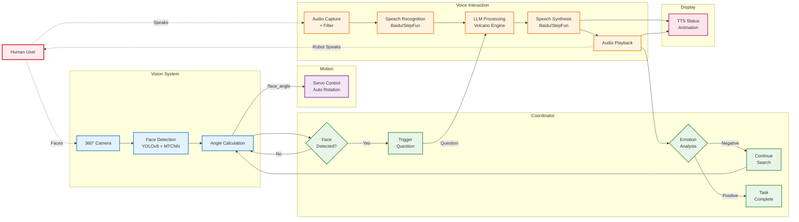

    

        

            <video class="hero-video" id="hri-hero-video" autoplay muted loop playsinline preload="auto"
                   aria-label="Proactive dialogue with panoramic perception and servo gaze">
                <source src="{{ site.baseurl }}/assets/video/hri_demo.MP4" type="video/mp4">
                Your browser does not support the video tag.
            </video>
        

        

            <strong>Demo</strong>: Proactive dialogue with panoramic perception and servo gaze.
        

    

## Abstract

Public-space robots must notice people who face them, start a conversation without being summoned, and respond with low-latency speech while keeping eye contact. This project builds an elevator-service HRI stack on **ROS2 Iron**: fisheye → equirectangular 360° perception, dual-stage human/face detection with facing-angle estimation, bilingual ASR/TTS, LLM intent analysis, a proactive state machine, and servo gaze that rotates to the selected user.

## Contributions

- End-to-end ROS2 Iron pipeline: **perception → understanding → decision → action**, with modular topics/services and swappable cloud providers.
- **360° panoramic perception** from fisheye images via equirectangular projection and multi-view splitting.
- **Dual-stage detection** (YOLOv8 + MTCNN) with facing-angle estimation on **0–360°**, published on `/face_angle`.
- **Bilingual ASR/TTS** (Baidu / StepFun) and **LLM intent analysis** (Volcano Engine) for dialogue.
- **Proactive questioning + state machine** (Idle → Questioning → Playback → Decision) with target switching.
- **Servo gaze control** that rotates the platform to face the selected user for user-centric interaction.

## Method

Loop: panoramic vision continuously searches for the closest face looking at the robot → publish `/face_angle` → servo turns to the user → proactive question → ASR → LLM → TTS → playback → sentiment/intent decides continue vs. end.

Module map:

- **Visual perception**: `usb_cam`, `fisheye_process`, `human_detect` (YOLOv8 + MTCNN) → `/face_angle`
- **Voice**: `audio_capture` → Baidu/StepFun ASR → `llm_bytedance` → TTS → `audio_play_python`
- **Motion**: `servo` subscribes to `/face_angle` for tracking / eye contact
- **Coordinator**: `interaction_coordinator_node`, `active_questioning_node` own the interaction state machine
- **Display**: `robot_animation_display` mirrors TTS status from `/audio_generated` and `/audio_playback_complete`

Why this split: cloud ASR/TTS/LLM stay replaceable behind ROS interfaces; local vision + servo keep the closed loop for gaze even when providers change.

    Perception → servo gaze → proactive dialogue → intent decision → continue or terminate.

### Typical interaction flow

1. Fisheye capture → panoramic views.
2. Detect human/face, estimate facing angle, publish `/face_angle`.
3. Rotate to face the target; ask a question proactively.
4. ASR → LLM intent → TTS playback.
5. Terminate or continue searching based on sentiment / keywords.

## Results

Reported operating numbers from tested scenes:

- **Latency**: end-to-end &lt; **3 s** (face detection → playback completion)
- **Perception**: face detection accuracy &gt; **95%**; multi-person selection supported
- **Speech**: practical ASR accuracy &gt; **90%** (Chinese/English) with VAD and segmentation
- **Architecture**: modular nodes with swappable cloud services for continuous public-space operation

## Failure Cases / Limitations

- Numbers are from **tested scenes**, not a large public HRI benchmark; crowded-elevator stress tests are incomplete.
- Dialogue quality and latency depend on **external cloud** ASR/TTS/LLM providers.
- Emotion / intent understanding is keyword- and LLM-prompt based; gesture / richer non-verbal cues are unfinished.
- Multilingual coverage beyond Chinese/English and stronger multimodal LLMs are not yet integrated.
- Safety filters for public speech content need further hardening.

## Project Team

- **Lead developer**: Jiajie Zhang (zhangjj2023@shanghaitech.edu.cn)
- **Collaborator**: Yongqi Zhang (zhangyq2023@shanghaitech.edu.cn)
- **Advisor**: Professor Sören Schwertfeger

## Related Resources

- **Code**: [HRI-Campus](https://github.com/jiajiezhang7/HRI-Campus)
